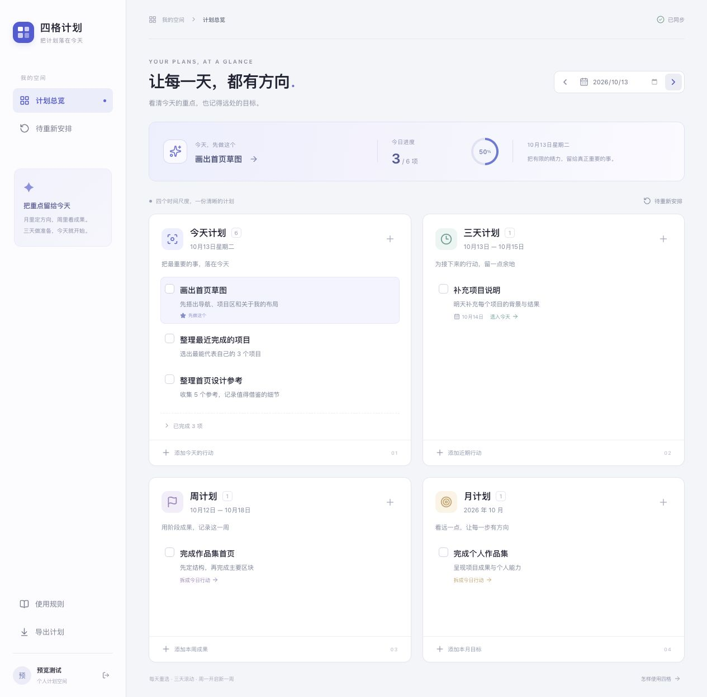
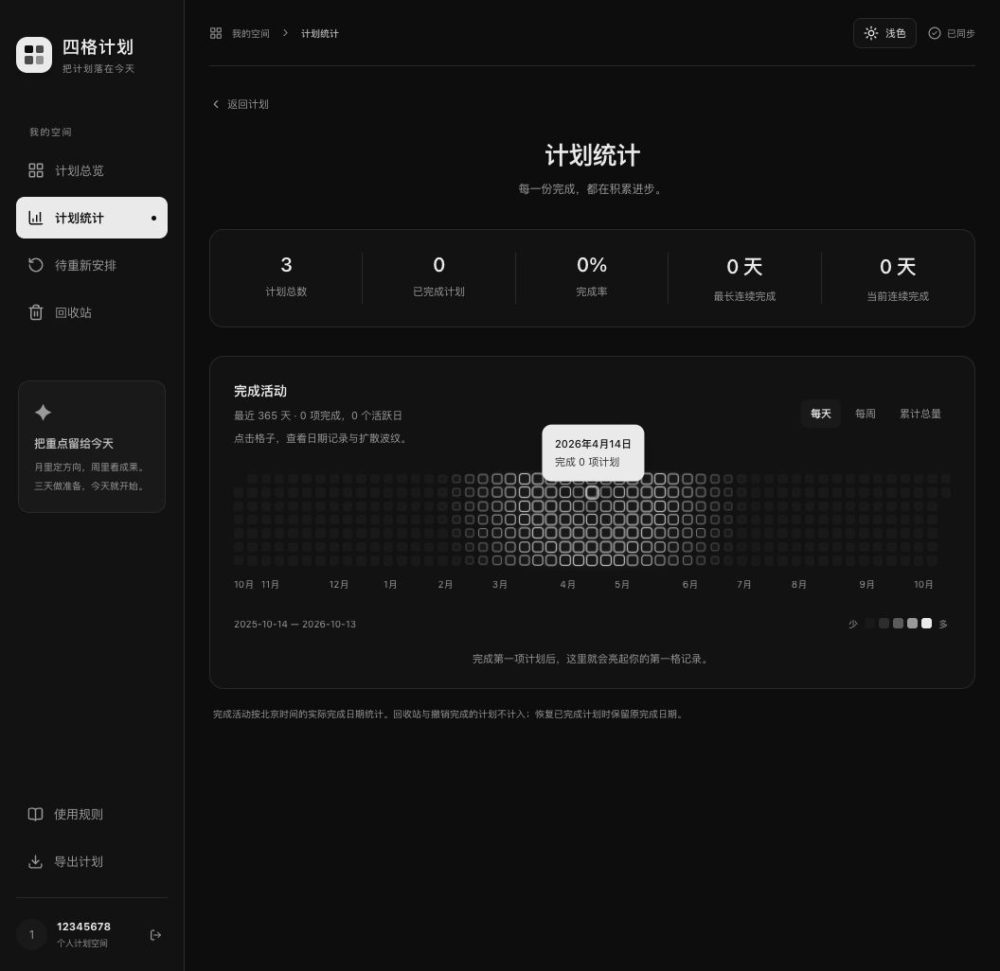

<div align="center">
  <h1>四格计划</h1>
  <p><strong>把计划落在今天，也给更远的目标留出位置。</strong></p>
  <p>个人计划工具 · 本地数据 · 桌面与手机</p>
</div>

## 产品展示

### 计划总览

<p align="center">
  
</p>

### 计划统计

<p align="center">
  
</p>

<p align="center">
  更多界面：<a href="docs/preview-mobile.jpg">手机端</a> · <a href="docs/preview-recurring-total-progress.png">持久计划</a>
</p>

## 四个时间视角

| 视角 | 适合安排             |
| ---- | -------------------- |
| 今天 | 选出眼下最重要的一步 |
| 三天 | 留出近期行动的余地   |
| 本周 | 记录阶段成果与下一步 |
| 本月 | 看清更长线的方向     |

计划可以在四个视角之间移动。周计划和月计划也能拆成今天可以开始的行动。

## 功能

- **轻量看板：** 新建、编辑、完成和移动计划；支持备注、日期调整、拖放与键盘操作。
- **今日重点：** 每天标记一项优先计划，帮助把注意力放在最重要的事情上。
- **持久计划：** 设置每日目标和持续日期，逐日生成独立任务；可暂停、恢复或停止，历史记录会保留。
- **待重新安排与回收站：** 过期未完成的普通计划不会自动顺延；可手动改期，误删内容可恢复。
- **完成统计：** 查看完成率与连续完成天数；按日、周或累计总量浏览活动热力图，也可以查看历史年份。
- **轻柔动效：** 统计热力图会以边框波纹提示日期活动；图标、卡片和主题切换也有响应动效，并遵循系统的减少动态效果设置。
- **个人设置：** 浅色与深色主题、每日鼓励语，以及本地 Go 堆内存和 SQLite 文件用量。

## 快速开始

### 环境要求

- Node.js 22.12 或更高版本
- pnpm 12.3.4
- Go 1.27 或更高版本

### 启动开发环境

在项目根目录运行：

```sh
pnpm install
pnpm dev
```

打开 [http://127.0.0.1:5178](http://127.0.0.1:5178)。首次使用时创建个人账号，之后使用同一账号登录。项目没有预置账号或默认密码。

开发模式会构建并启动 Go API 与 Vite。修改前端会自动刷新；修改 Go 代码后重新运行 `pnpm dev`。按 Ctrl+C 可同时停止开发服务。

### 在手机或其他电脑上试用

确保设备连接到同一 Wi-Fi，在项目根目录启动：

```sh
HOST=0.0.0.0 pnpm dev
```

然后在另一台设备打开运行电脑的局域网 IP 加端口，例如 `http://192.168.1.10:5178`。这是用于可信局域网的开发测试方式，请勿直接暴露到公网。

## 常用命令

| 命令         | 说明                                     |
| ------------ | ---------------------------------------- |
| `pnpm dev`   | 启动开发 API 和 Vite，前端修改后自动刷新 |
| `pnpm check` | 检查 TypeScript 并运行 Go vet            |
| `pnpm test`  | 运行 Go 测试                             |
| `pnpm build` | 构建前端和 Go 服务                       |
| `pnpm start` | 启动构建后的本地服务                     |

运行 `pnpm start` 前先执行 `pnpm build`，然后打开 [http://127.0.0.1:8788](http://127.0.0.1:8788)。

## 配置与数据

可将 `.env.example` 复制为 `.env`。不配置时，服务仅监听本机地址，使用项目目录中的默认数据库。

| 变量            | 默认值           | 用途                                                  |
| --------------- | ---------------- | ----------------------------------------------------- |
| `HOST`          | `127.0.0.1`      | 服务监听地址；局域网开发时可设为 `0.0.0.0`            |
| `DATA_PATH`     | `.data/plans.db` | SQLite 数据库文件路径                                 |
| `PORT`          | `8788`           | `pnpm start` 使用的服务端口；开发 API 固定使用 `8788` |
| `COOKIE_SECURE` | `false`          | 通过 HTTPS 提供服务时设为 `true`                      |

账号、计划和每日语录缓存保存在 SQLite 中。可从界面导出 JSON 备份。不要提交 `.env`、`.data` 或包含个人计划的导出文件。

本项目面向个人本地使用。多设备访问同一份数据时，需要让设备连接同一个后端；分别在多台电脑启动服务会使用各自的本地数据库。当前没有配置云端部署，资源面板也只显示本地 Go 与 SQLite 的用量。

每日鼓励语只请求固定的「鼓励」分类，不会上传用户名、计划内容或完成记录；请求失败时使用内置文案。

## 技术栈

- 前端：React、TypeScript、Vite、Motion、Three.js
- 后端：Go、Gin
- 数据：SQLite

## 部署说明

当前仓库提供本地开发和运行配置，尚未提供云端部署流程。部署到公网前，需要为数据库配置可靠的持久化存储，并启用 HTTPS、安全 Cookie 和备份。
